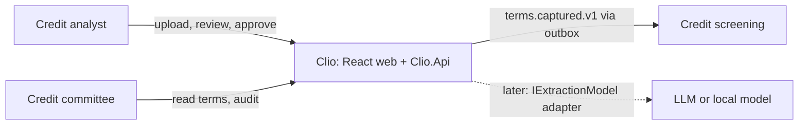

# Architecture

## Style and why
Advisor output (traits: DocumentIngestion, RegulatoryAudit, ComplexBusinessRules, SmallTeam):

### Recommendation: CleanArchitecture

One business area with rules that must be tested without the database or UI. Keep the domain at the centre.

#### Patterns
- **AuditTrail**: Keep an immutable record of who did what and when; regulators and clients will ask.
- **SeparateIngestionPipeline**: Documents arrive in bursts; queue them and process in a worker so the API stays responsive.
- **HumanInTheLoop**: AI extraction is never 100%: route low-confidence fields to a person and learn from their corrections.

#### Closest reference systems
- Document extraction with human review (similarity 1.00): Clean Architecture API plus a worker fed by a queue; fields the model is unsure about wait for a person.
- Employee tool (leave, timesheets) (similarity 0.40): Monolith: layered, or Clean Architecture if the approval rules are complex.
- Clinic or hospital patient system (similarity 0.33): Clean Architecture or modular monolith, with a full audit history.

#### Risks to watch
- Trusting AI output blindly. Validate against a schema and keep a person in the loop.

#### Evolve when
- A second business area appears with its own language: make it a module of a modular monolith.

Record the final choice with write_adr, including what you rejected.

Judgement: Build a Clean Architecture API with a separate extraction worker fed by a queue, and a review queue for low-confidence fields. See `decisions/0001-architecture-style.md`.

Further decisions: `0002-vendored-building-blocks.md`, `0003-pluggable-extraction-model.md`, `0004-in-process-worker-with-channels.md`.

## Context

## Modules and boundaries
Dependencies point inwards: Api -> Infrastructure -> Application -> Domain (enforced by `tests/Clio.Tests/Architecture`).

| Project | Owns | May call |
|---|---|---|
| `src/Clio.Domain` | `TermSheetDocument` aggregate, `ExtractedField`, `FieldValueRules` (value schema), `PlausibilityRules`, `ConfidenceThreshold` | BCL, `Agentic.Blocks.Core` |
| `src/Clio.Application` | `TermSheetService` (upload, process, approve, queue, page, original), ports, `ExtractionEvaluator` | Domain |
| `src/Clio.Infrastructure` | `RulesExtractionModel`, `CompositeDocumentTextReader` (plain text + minimal PDF), in-memory stores, `ExtractionChannel`, audit and outbox adapters, screening hand-off handler, `EvalSetLoader`. Internal except `DependencyInjection`, `EvalSetLoader` | Application, Audit and Outbox blocks |
| `src/Clio.Api` | composition root (`ClioApp`), endpoints, auth policies, `ExtractionWorker` (BackgroundService), dev seeding, `eval` command | all |
| `web/` | React SPA: login, upload, document list, field table, source page, review queue | API over HTTP |

## Cross-cutting
- **Auth:** Agentic.Blocks.Auth bearer tokens; roles `analyst` (write) and `committee` (read + audit). Demo users seeded in Development only.
- **Errors:** `Result`/`Error` from Core, ProblemDetails via Agentic.Blocks.Web (`code`, `traceId`, `correlationId`).
- **Audit:** Agentic.Blocks.Audit, hash-chained; actions `document.uploaded`, `document.unreadable`, `document.failed`, `field.auto_accepted`, `field.approved`.
- **Events:** Agentic.Blocks.Outbox, `terms.captured.v1` when all three terms are saved; handler idempotent on message id.
- **Logging/tracing:** source-generated log messages (ids only), ActivitySource `Clio.Extraction`, correlation id per request.
- **Configuration:** `Extraction:*` (threshold, max upload, queue capacity, model), `Demo:Password`, `Seed:SamplesPath`; see `.env.example`.
- **Time and money:** `TimeProvider` everywhere; amounts validated through Core `Money` (decimal, ISO 4217).
