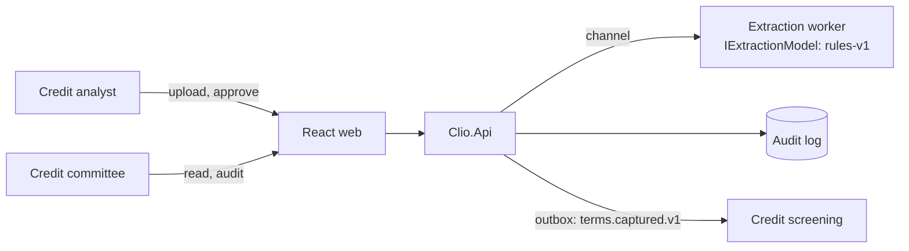

# Clio

Clio extracts loan terms from term sheets for Harbourline Lending's credit analysts (Harbourline is fictional; all data is invented).
Analysts used to copy terms out of scanned term sheets by hand, which delayed screening by days and caused keying errors.

## Design at a glance
Upload a term sheet; Clio proposes **loan amount, margin and maturity**, each with a confidence and the page and line it came from.
Values at or above 0.90 are saved; the rest wait in a review queue, and every approval records who approved it in a tamper-evident audit log.

**Architecture: Clean Architecture monolith** (Domain, Application, Infrastructure, Api) with an extraction worker
(`BackgroundService` fed by a bounded `System.Threading.Channels` channel) in the API process. One business area whose
rules must be tested without a database, UI or model, two engineers, ~200 documents a month: a distributed design would add
cost and no benefit, while Clean Architecture keeps the extraction model a swappable adapter (rules today, LLM or local model
later, ADR-0003). Full reasoning, capacity sums, failure modes and Q&A: [`docs/DESIGN.md`](docs/DESIGN.md).



## What it does (slice 1)
- `POST /api/documents`: text-layer PDF, `.txt` or `.md` (10 MB max). Same file twice returns the same document.
- Fields with value, confidence, source page/line, status (auto-accepted, needs review, approved by).
- Review queue, approve with optional correction (analyst role), committee is read-only.
- Unreadable files (no text layer, binary, corrupt PDF) get a plain error; the original stays downloadable.
- Eval set of 17 labelled invented documents (`eval/`) with a runner that reports per-field accuracy and gates CI.

## Run locally
```bash
# API on http://localhost:5201 (Development seeds invented samples and two demo users)
Demo__Password='pick-a-local-demo-password' ASPNETCORE_ENVIRONMENT=Development \
  dotnet run --project src/Clio.Api
# Web on http://localhost:5173 (proxies /api, /auth, /audit to 5201)
cd web && npm ci && npm run dev
```
Sign in as `analyst@example.com` or `committee@example.com` with that password. More (tests, eval, offline builds): `.agentic/runbook.md`.

## How this project is organised
`src/` four Clean Architecture projects, `tests/Clio.Tests` (domain, adapters, acceptance, eval, architecture), `web/` React app,
`eval/` labelled documents, `samples/` demo files, `prompts/` the LLM port's prompt and schema, `eng/packages/` vendored building blocks.
Project knowledge lives in the hidden `.agentic/` folder (start with `.agentic/README.md`). AI agents read `AGENTS.md` first.

Built with the Baton model from the Agentic Engineering Kit: frame → map → decide → sketch → slice loop → pass the baton.
