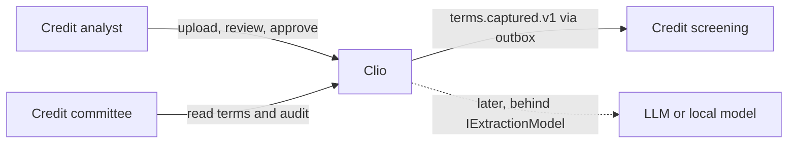
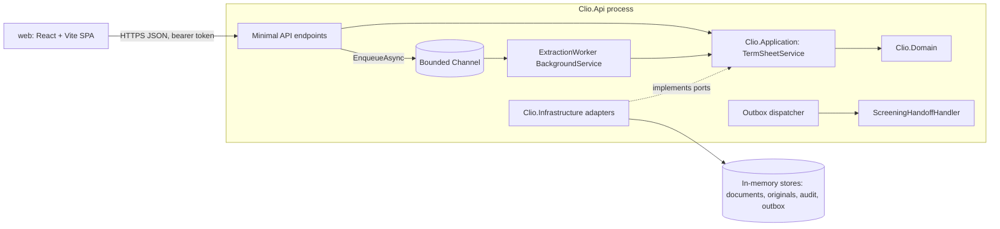
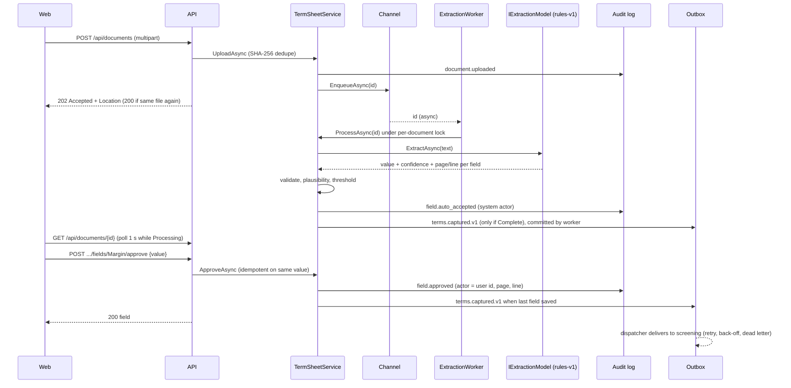
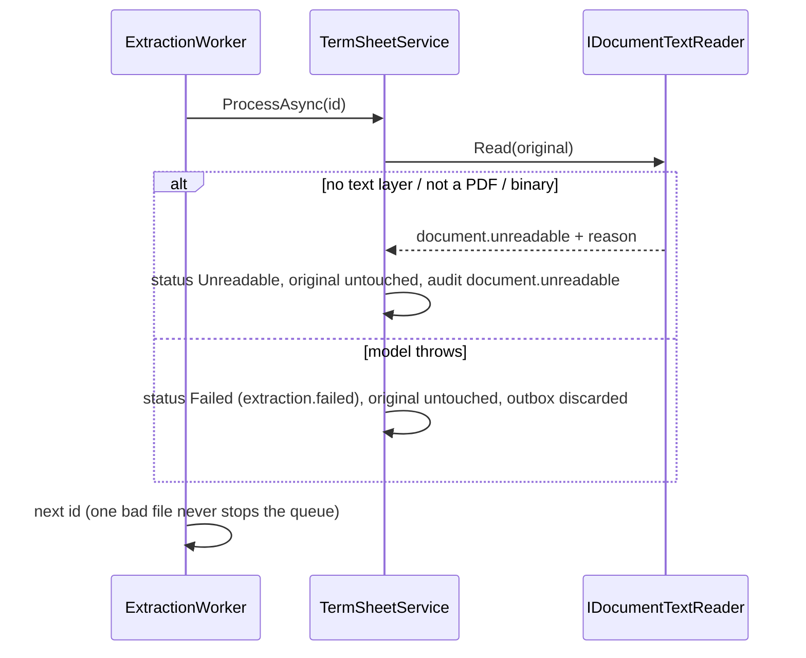
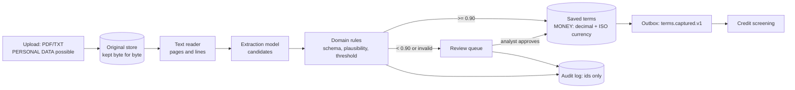
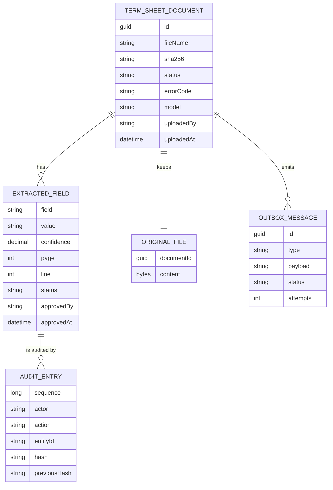

# Clio: design dossier

> Harbourline Lending is a fictional company. Every name, document and number here is invented.

## 1. Brief
- **Client:** Harbourline Lending, credit team.
- **Problem:** analysts copy loan terms out of scanned term sheets by hand. Screening waits days and keying errors creep in.
- **Users:** credit analysts (daily, expert, keyboard-heavy) upload and approve; the credit committee (weekly) reads only.
- **Outcomes:** terms captured in under 5 minutes per document (today about 45); fewer than 1 in 200 fields corrected after approval; every value links to its page.
- **Product:** Clio reads a term sheet, proposes loan amount, margin and maturity with a confidence and a page/line for each, saves the sure ones and queues the rest for a person.

## 2. Requirements
**Functional (slice 1, `.agentic/backlog.md`):**
1. Upload a term sheet (text-layer PDF, .txt, .md); see amount, margin, maturity with confidence and a link to the page.
2. Fields under the threshold (0.90) go to the review queue and are not saved.
3. Approving a field stores its source page/line and the approving user, and writes an audit entry.
4. An unreadable file gives a clear error; the original is kept and downloadable.

**Non-functional:**

| Concern | Target | Source |
|---|---|---|
| API latency | p95 < 300 ms (reads, upload accept) | `quality.md` |
| Availability | 99.9% / 30 days (business hours matter most) | `quality.md` |
| Freshness | upload to extracted < 10 s p95 (rules), < 60 s (LLM later) | assumption |
| Accuracy | per-field eval accuracy >= 85%; auto-accepted values 100% right on the eval set | ADR-0003 |
| Retention | originals and audit kept 7 years (credit file); audit append-only | assumption, confirm with compliance |
| Privacy | POPIA: borrower data stays in Harbourline's tenancy; no provider calls without a contract; logs hold ids only | `product.md` |

## 3. Capacity estimate
Assumptions: 200 documents a month (product.md), 3 pages and 300 KB average, 10 analysts, month-end burst of 50 documents in one hour.
- **Writes:** 200 / 22 working days ≈ 10 uploads a day; burst 50/hour ≈ 0.014/s. Each upload ≈ 3 approvals ⇒ < 1,000 writes a month.
- **Reads:** 10 analysts × 300 requests a day (polling every 1 s only while a document is being read) ≈ 3,000/day ≈ 0.1 rps average, < 5 rps peak.
- **Worker:** rules extraction takes milliseconds per document; an LLM at ~15 s per document still clears the 50-document burst in ~13 minutes with one worker.
- **Storage:** 200 × 12 × 0.3 MB ≈ 0.7 GB of originals a year (round to 1 GB); field rows and audit entries < 50 MB a year.
- **Cost of an LLM adapter (later):** ~3 pages × 1.5k tokens ≈ 5k tokens per document ⇒ ~1M tokens a month: single-digit dollars. Budget cap and alert still apply.
Conclusion: one small instance is plenty; the design is driven by correctness and audit, not scale.

## 4. Options considered
`arch-advisor compare DocumentIngestion RegulatoryAudit ComplexBusinessRules SmallTeam`:

| Option | Fit | Complexity (1-5) | Main reason |
|---|---|---|---|
| Clean Architecture monolith | Recommended | 2 | Matches the advisor's recommended style (CleanArchitecture). |
| Layered monolith | Possible | 1 | Small team: low enough operational load to run comfortably. |
| Vertical slice monolith | Possible | 2 | Small team: low enough operational load to run comfortably. |
| Modular monolith | Possible | 3 | Small team: low enough operational load to run comfortably. |
| Modular monolith + CQRS read models | Possible | 3 | Small team: low enough operational load to run comfortably. |
| Serverless functions + queues | Possible | 3 | Small team: low enough operational load to run comfortably. |
| Event-sourced core with CQRS | Possible | 4 | Audit: the event log is the audit trail, with replay for free. |
| Static site + serverless function | Poor fit | 1 | The product has real server-side behaviour and data; a static site can't hold it. |
| Microservices (request/response) | Poor fit | 5 | A small team can't run a distributed system well (deployments, tracing, on-call). |
| Event-driven microservices | Poor fit | 5 | A small team can't run a distributed system well (deployments, tracing, on-call). |

- **Clean Architecture monolith (chosen):** one business area whose rules (validation, plausibility, threshold routing, approval) must be tested without a database, UI or model. The domain sits at the centre and the model, readers, stores, queue and audit are adapters, which is exactly the "swap the model for a local one" constraint.
- **Layered monolith:** fastest, but model calls and validation would leak into endpoints; swapping the model would touch HTTP code.
- **Vertical slices:** good for many small features; Clio has one pipeline with shared rules every slice would need.
- **Modular monolith:** worth it when a second business area appears (e.g. covenant monitoring). Today it would be one module.
- **Serverless + queues:** fits bursty ingestion, but cold starts, local testing and an extra platform for 10 documents a day.
- **Event sourcing:** gives audit for free, but the Audit block's hash-chained log already answers "who approved what" at a fraction of the learning cost.
- **Microservices:** two engineers, one area, no independent scaling need.
- **Global scale:** not a trait here (one lender, one region). If Clio became a multi-lender product: tenant-partitioned storage, a broker-fed worker pool per region, model adapters per region for data residency.
- **Evolve when (ADR-0001):** a second business area with its own language appears: turn the layers into modules of a modular monolith.

## 5. Architecture
**C4 context**

**C4 containers**

| Project | Owns | May reference |
|---|---|---|
| `Clio.Domain` | `TermSheetDocument` (aggregate), `ExtractedField`, `FieldValueRules` (schema), `PlausibilityRules`, `ConfidenceThreshold` | BCL, `Agentic.Blocks.Core` (Result, Money) |
| `Clio.Application` | `TermSheetService` use cases, ports (`IExtractionModel`, `IDocumentTextReader`, `IDocumentRepository`, `IOriginalFileStore`, `IExtractionChannel`, `IAuditTrail`, `IIntegrationEvents`), `ExtractionEvaluator` | Domain |
| `Clio.Infrastructure` | rules extractor, text/PDF readers, in-memory stores, channel, audit and outbox adapters, eval loader; only `DependencyInjection` and `EvalSetLoader` are public | Application, Audit, Outbox blocks |
| `Clio.Api` | composition root, endpoints, auth policies, `ExtractionWorker`, dev seeding, `eval` command | everything |

The direction is enforced by `tests/Clio.Tests/Architecture/DependencyDirectionTests.cs`.

**Endpoints:** `POST /api/documents`, `GET /api/documents`, `GET /api/documents/{id}`, `GET /api/documents/{id}/original`, `GET /api/documents/{id}/pages/{n}`, `POST /api/documents/{id}/fields/{field}/approve`, `GET /api/review-queue`, `GET /api/screening/handoffs`, `/auth/*` (Auth block), `/audit/*` (Audit block, committee role), `/health/live`, `/health/ready`.

## 6. Communication flows
**Slice 1: upload, extract, review, approve**

**Riskiest flow: unreadable or crashing file**

Sync: HTTP upload/read/approve. Async: channel to worker, outbox to screening. Idempotency: uploads by content hash; approvals by "same value is a no-op, different value is 409"; outbox handler de-duplicates on message id.

## 7. Data flow

Personal data lives in originals and page text only. Field values are commercial terms; audit entries carry user ids and page/line, never document text.

## 8. Data model

| Entity | Owner | Consistency |
|---|---|---|
| Document + fields | Domain aggregate via `IDocumentRepository` | strong (per-document lock now, row version in slice 2) |
| Original file | `IOriginalFileStore` | strong, written before the document is queued |
| Audit entry | Audit block | append-only, hash-chained, strong order |
| Outbox message | Outbox block | at-least-once delivery, eventual at screening |

## 9. Scaling path
1. **Restart loses in-memory state** (first to break): slice 2 adds a database (documents, fields, outbox, audit in one transaction) and blob storage for originals; the worker re-queues `Received` documents at start-up.
2. **Slow model:** run 2-4 worker loops on the channel (per-document lock already serialises a document).
3. **Several API instances:** swap `IExtractionChannel` for a broker queue; outbox lease is already atomic-ready; persist the Data Protection key ring for tokens.
4. **Heavy reading by committee:** a read model of captured terms (or a reporting replica).
5. **A second business area:** split into modules (modular monolith). Extracting the worker into its own service is the last step, only if its load or release cadence differs.

## 10. Failure modes
| Failure | Effect | Mitigation |
|---|---|---|
| File has no text layer / is binary | no fields | `Unreadable` with a plain reason, original downloadable, audit entry |
| Extractor throws | document stuck | caught per document: `Failed`, original kept, worker continues |
| Model returns invalid value | wrong data saved | `FieldValueRules` rejects it: value null, confidence 0, review queue |
| Plausible-looking but wrong value (past maturity, margin > 10%) | silent error | `PlausibilityRules` caps confidence at 0.5 so a person sees it |
| Conflicting values in one document | wrong pick | confidence capped at 0.6, note names both lines |
| Duplicate upload | double work | SHA-256 dedupe returns the existing document (200) |
| Double-click approve / retry | double audit | same value is a no-op; different value is 409 |
| Screening down | hand-off lost | outbox retries with jittered back-off, then dead letter for replay |
| Burst of uploads | memory growth | bounded channel (500) applies back-pressure |
| Process restart | queued work lost (slice 1) | slice 2 persistence + re-queue on start |
| Region outage | Clio down | single region accepted (internal tool); restore from backups, RPO 24 h assumption |

## 11. Security and privacy
- **AuthN:** Auth block bearer tokens (PBKDF2 600k, lockout, logout revokes). OIDC can replace it without endpoint changes.
- **AuthZ:** `analyst` uploads and approves; `committee` reads documents and the audit log; anonymous gets 401, wrong role 403.
- **POPIA:** originals may hold borrower personal data; stored only in Harbourline's tenancy (encrypted blob storage in production), retention per credit policy, erasure handled in the store adapter. Logs and audit carry ids, never document text. The rules model keeps all data in-process; an LLM adapter needs a data-processing contract or a local model.
- **Secrets:** none in the repo; demo password via `Demo__Password` (Development only), `.env.example` documents keys; gitleaks and the privacy guard run in CI.
- **Threats per flow:** upload (size limit 10 MB, content sniffed, no execution, PDF reader is a pure parser with no external references), approve (role check, value schema), audit (append-only, `GET /audit/verify` detects tampering), rate limiting on `/api` and `/auth`.

## 12. Observability
| SLI | SLO |
|---|---|
| API success rate (non-5xx) | 99.9% / 30 days |
| p95 API latency | < 300 ms |
| Upload to extracted (p95) | < 10 s |
| Auto-accept precision (weekly sample of approved vs auto-accepted) | >= 99.5% |
| Fields corrected after approval | < 1 in 200 |
- **Metrics:** documents by status, review-queue length and age, outbox pending/dead-lettered (`agentic.blocks.outbox.*`), extraction duration.
- **Traces:** ActivitySource `Clio.Extraction` per document; correlation id from `X-Correlation-Id` on every request, problem and audit entry.
- **Wake-someone alert:** outbox dead letters > 0 or review-queue oldest item > 1 working day; error-budget burn > 10x for 1 hour.

## 13. Testing strategy
| Layer | What | Where |
|---|---|---|
| Rules | value schema, plausibility, aggregate transitions, approval idempotency | `tests/Clio.Tests/Domain` |
| Adapters | text/PDF reader (compressed, uncompressed, no text layer, corrupt), rules extractor phrasings, channel, idempotent hand-off | `tests/Clio.Tests/Infrastructure` |
| Acceptance | real HTTP on Kestrel (Blocks `KestrelTestHost`), seeded invented users | `tests/Clio.Tests/Acceptance` |
| Accuracy | 17 labelled invented documents, per-field accuracy >= 85% and auto-accept precision 100% | `tests/Clio.Tests/Eval`, `eval/`, CI eval step |
| Boundaries | dependency direction, internal adapters | `tests/Clio.Tests/Architecture` |
| Web | formatting, status labels, component states (server-rendered) | `web/src/**/*.test.ts(x)` |

| Acceptance criterion | Test |
|---|---|
| Clear term sheet: three fields >= 0.9 | `Given_a_clear_term_sheet_...`, `Given_a_clear_text_layer_pdf_...` |
| Below threshold: review queue, not saved | `Given_a_field_below_the_threshold_...` |
| Approved: source page + approver stored | `Given_an_approved_field_...` (also checks the audit entry) |
| Unreadable: clear error, original kept | `Given_an_unreadable_file_...` |

## 14. Interview questions
1. **Why not call an LLM straight away?** Deterministic rules handle labelled term sheets well, cost nothing, keep borrower data in-process and make CI repeatable. The LLM is a second adapter behind `IExtractionModel` and must beat the same eval set.
2. **How do you stop the model saving a wrong number?** Three gates: schema validation, plausibility rules, and a threshold tuned so auto-accepted values were 100% right on the eval set. Everything else waits for a person.
3. **What if the worker crashes mid-document?** The original is written before queueing; the failure marks the document Failed and the loop continues. With persistence, `Received` documents are re-queued at start.
4. **The same file is uploaded twice?** SHA-256 dedupe returns the existing document with 200.
5. **Screening receives the event twice?** Delivery is at least once; the handler de-duplicates on the outbox message id, so the effect is exactly once.
6. **How would you handle 100x volume?** Persist state, run several worker loops, then swap the channel for a broker and scale workers out. The domain and use cases do not change.
7. **How does an auditor see where a number came from?** Each field stores page, line and evidence; `GET /audit/entities/term-field/{doc}:{field}` shows who auto-accepted or approved it, and `/audit/verify` proves the log was not edited.
8. **How do you change the threshold safely?** It is config; re-run the eval (`dotnet run --project src/Clio.Api -- eval eval`) and only lower it if auto-accept precision stays at the bar.
9. **What would make you split this into services?** A second business area with its own language and team, or a worker whose load or release cadence clearly differs from the API.
